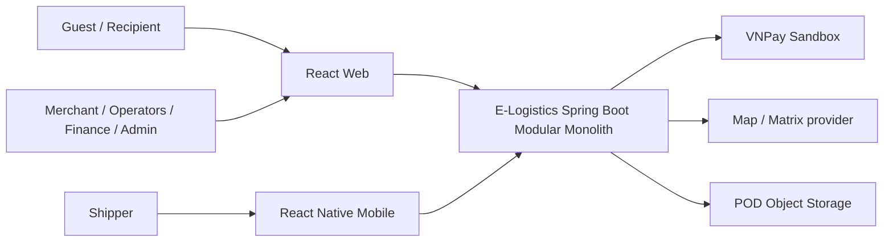
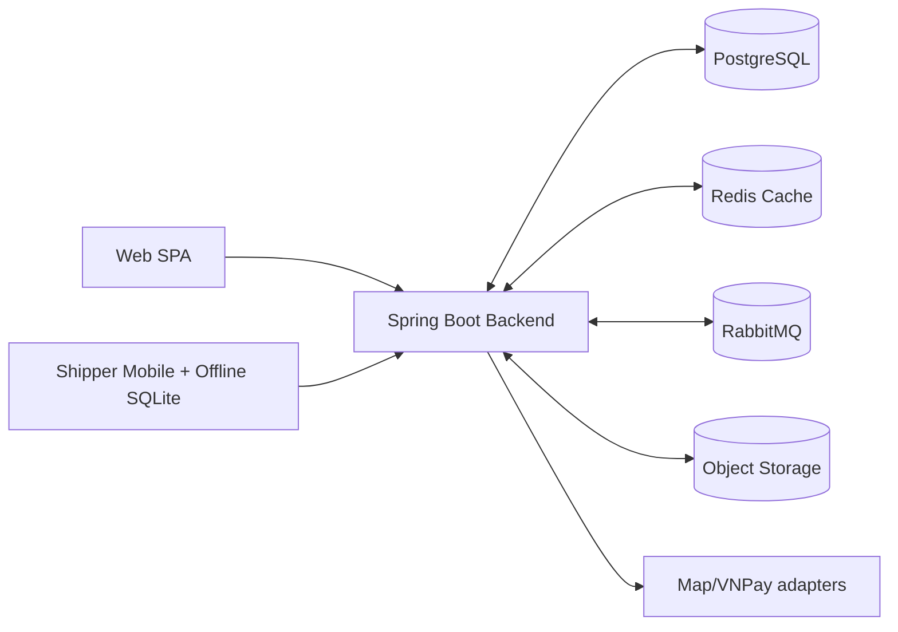
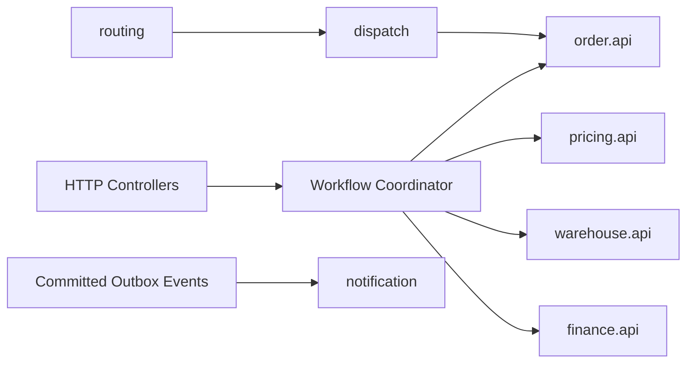

# Architecture Overview — Modular Monolith Microservice-ready

**Trạng thái:** [REPORT] quyết định triển khai Modular Monolith, một backend Java/Spring Boot và PostgreSQL dùng chung; [PROPOSED] các chi tiết hợp đồng API/CI chưa nằm trong báo cáo.

## 1. C4 System Context (logical)

## 2. C4 Container (deployment)

## 3. Logic trong backend

**Quan trọng:** logic graph chỉ mô tả trách nhiệm, không phải nhiều process/microservice hoặc yêu cầu REST nội bộ. `identity`, `merchant`, các module còn lại nằm cùng backend artifact.

## 4. Rule-of-thumb để thiết kế
- Định nghĩa command/query/event contract từ use case trước khi tạo controller.
- Đặt domain invariants vào aggregate/domain service; việc điều phối multi-module vào `workflow` ở lớp application.
- Use case phức tạp: `internal/{web,application,domain,infrastructure}` theo Clean Architecture; CRUD ít logic: có thể giản lược tầng khi không phá dependency.
- Truyền ID và DTO công khai qua boundary. Không trao persistence entity/JPA association ngoài module.
- DB là nguồn sự thật; Redis chỉ cache; RabbitMQ chỉ vận chuyển tác vụ có thể trễ.
- Không gọi API map/payment bên trong transaction tiền/tồn; tách chuẩn bị dữ kiện/verification có hạn chờ.

## 5. Tương thích định hướng Microservices
- Schema/domain owner độc lập về write; các hợp đồng có thể version; không tạo call cycle.
- Cross-schema FK nếu cần và dùng chung DB được [REPORT] cho phép có kiểm soát, nhưng ghi nhận coupling tại ADR.
- Không tạo `Saga` cho P0 khi thao tác vẫn có thể dùng transaction cục bộ; không hứa việc tách service sau này là không cần refactor.

## 6. Nghiệm thu kiến trúc
- Một backend chạy qua Compose với migration, health, readiness, seed demo.
- Compile/module verification pass; không `othermodule.internal` import; không SQL cập nhật bảng của owner khác.
- Có tài liệu kịch bản khởi động, lỗi phụ thuộc và bản kiểm chứng RQ1–RQ4.
