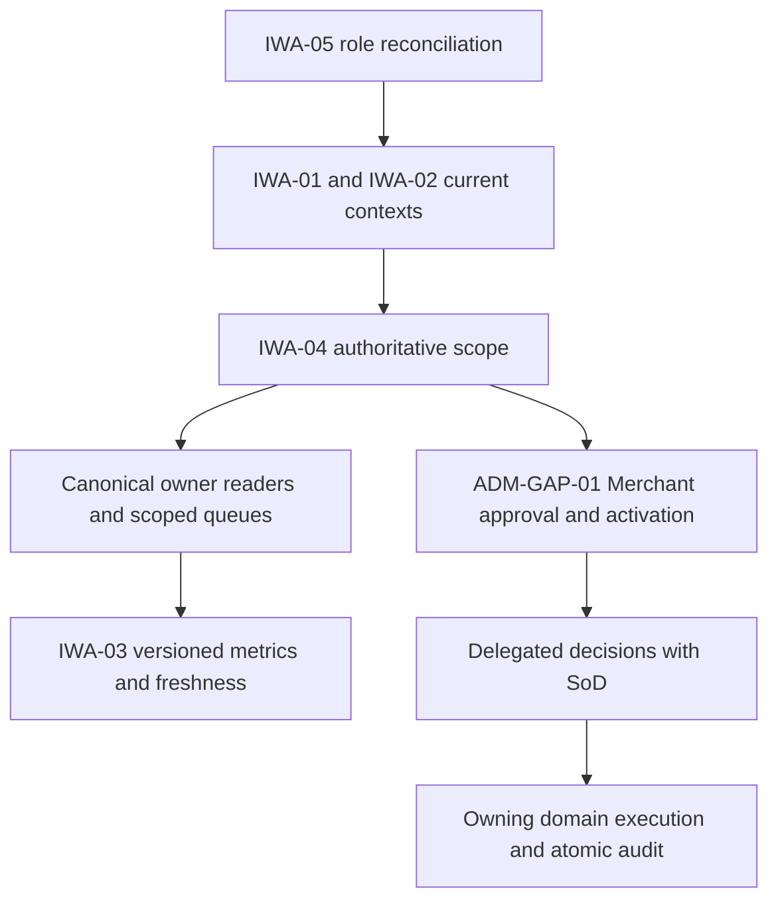

# Consolidated Internal Administration technical amendment

Status: **PROPOSED — NOT IMPLEMENTED**. Owner2026-11-23 authorizes only existing-
contract improvements while this exact new authority is reviewed. This is the
single consolidated gap checkpoint; no grants, schema or policy have been added.
Parent approved Admin contracts and V39/V40 remain byte-identical.

## Existing scope does not need repeat approval

Shared React application/shell, nine parent groups,23-module traceability, six
Dashboard tabs, current-context display, existing six Admin GET APIs, snapshot-
safe lists, source/dependency states and CSKH reuse with its existing transport.
No new wire field, Backend route, DB table or permission is needed for these.

## Original gap inventory — superseded for P0 by the bounded package below

The following rows preserve the initial gap analysis, not the current executable
P0 proposal. In particular IWA-01/02 generic discovery/switching is deferred and
IWA-03 unconditional additive metadata is replaced by opt-in v2 negotiation.

| ID | Proposed technical surface | Security and dependency |
|---|---|---|
| IWA-01 | Read interface `InternalContexts.current(AuthenticatedPrincipal)` and GET `/api/v1/internal/contexts`; DTO `InternalContextPage` with contexts and each context's `contextId`, `portal`, `principalKind`, `environment`, `permissions`, `resourceScopes`, `authorizationVersion` | Return only currently persisted contexts of the authenticated identity; no enumeration/union of unrelated SYSTEM/SUPPORT/Customer identities. Reuse existing session engines. No implicit operator action or new login engine. |
| IWA-02 | Extend target-portal admission to validate server-issued context ID, current assignment and exact permission on each request | Controlled Identity amendment required: existing dedicated Admin and SUPPORT purposes are intentionally separate. No generic cross-purpose token or role-label bypass. Default deny until target port exists. No cross-portal switch implementation before approval. |
| IWA-03 | Proposed additive Dashboard DTO metadata: `metricDefinitionVersion`, `numerator`, `denominator`, `lastSourceEventAt`, `freshness` | Preserve all six API paths and exact old fields; version parser/compatibility plan first. Metric-specific counts/sums/rates, nullable fields where not applicable; source timestamps from owner ports, never browser refresh. No new MetricDefinition table merely for convenience. |
| IWA-04 | Authoritative Admin resource-scope port plus scoped filters/read queries | Must bind actual region/site/Organization grants to current context; no client-supplied authority or SYSTEM-realm-as-region. Exact assignment schema/permission compatibility remains design-blocked until source owner is identified. |
| IWA-05 | Reconcile target role namespace/templates against existing R28–R32 | No numeric relabeling, automatic migration or default grant. Approve exact role codes, permission sets, resource scopes and legacy compatibility before source/schema. |

The interface names/path/DTO fields above are review proposals only. No new
table/operator migration is proposed for the shared shell. Authentication
discovery does not itself allow mutable active context or elevate authority.

## Business-source dependencies and authority still missing

| ID | Modules | Required owner contract before implementation |
|---|---|---|
| ADM-GAP-01 |02/03 and Merchant Queue | Merchant submission/review/decision/activation, conflict checks, exact states, unique/idempotent org+Owner activation, legal/KYC access, scoped directory and lifecycle. Do not repurpose DRAFT as submitted or offline provisioning as approval. |
| ADM-GAP-02 |04/05/06/07 and Network | Official site/Partner/service registry, effective coverage, pricing proposal/publication and impact contracts; require current custody/open-work preflight and preserve Booking snapshots. |
| ADM-GAP-03 |08/09 and Network & SLA | Masked oversight detail/event reader, investigation request, policy/calendar/versioned SLA and committed Carrier lifecycle facts. No Admin event writer. |
| ADM-GAP-04 |10/11 | Governance-specific Ticket/Claim and financial readers/decisions; compensation policy/limits, maker-checker, audited PII and owning Finance execution. Existing CSKH access is not this permission. |
| ADM-GAP-05 |12/15/16/17 and Decisions | Scoped IAM/audit/security/task/notification readers, approved mutation/step-up/approval protocols. No approval task can be created through a READ API. Export needs purpose, row cap and audit. |
| ADM-GAP-06 |13/14 | Config registry, technical telemetry, retry/release privileges and environment-aware approval. Current endpoint availability proves only that endpoint responds. |
| ADM-GAP-07 |18–23 | Separate proposed delegated authority, taxonomy, data quality, BCP/DR, release and privacy/retention/legal-hold contracts. No invented retention periods, amount limits or recovery targets. |

These are identified contract gaps, not invented executable APIs/tables. Their
exact future technical manifests must be derived from the respective canonical
owners. This document does not preapprove broad endpoints or an alternate
cross-domain approval/grant engine. Keep policy decisions and domain execution
distinct; use the existing nine-domain backend artifact.

## Original broad dependency graph (not the P0 implementation sequence)

P0: current-context/scope reconciliation and Merchant approval/activation,
oversight/IAM/audit/account foundations. P1: network/policy/claims/finance governance,
delegation and quality. P2: platform/compliance/reference/continuity. P3: releases
and full cross-portal/Production acceptance. No module becomes complete from a menu.

## Required future evidence

Cross-purpose and cross-scope denial, revoked/expired assignments, no grant union,
Auditor no write, Root/IAM separation, requester/reviewer independence, approval
race/lost-response/idempotency, source event freshness and exact numerator/
denominator, PII/export purpose and audit, backward-compatible DTO parsing, PG18
FK/guards/rollback and real HTTPS Browser tests. No demo/UAT/Production migration,
activation or publication follows from reviewing this amendment.

## P0 consolidation — 2026-11-23, technical approval pending

The Owner approved direction/priority, not new API/DTO/schema/authority. The exact
bounded proposal is now:

- [P0 readiness and consolidated approval checklist](admin-p0-contract-readiness.md).
- [Identity/context and role resolution](admin-p0-identity-context-contract.proposed.md):
  P0 NO_LINKING, current canonical admissions stay separate; documentary aliases
  instead of numeric role rewrites. No internal-contexts API in this manifest.
- [Merchant Application/Activation](admin-p0-merchant-approval-contract.proposed.md):
  actual Customer submission, immutable revision, independent decision and atomic
  Organization/Initial Owner; no offline provisioning substitute.
- [Dashboard/supporting read contracts](admin-p0-dashboard-supporting-read-contract.proposed.md):
  unchanged default v1, opt-in v2 metadata/current Merchant scope, source-backed
  masked oversight/audit/derived work; no fictitious regional grant or task table.
- [Exact technical manifest](admin-p0-implementation-manifest.proposed.json) and
  [execution evidence](admin-p0-implementation-execution.md).

This package replaces the broad IWA-01–05 sketches for the specified P0 scope only.
Other ADM-GAP-02–07 requirements remain future dependencies, not silently approved
endpoints. Merchant approval no longer waits on a generic cross-portal linking
engine. All new authority remains PROPOSED; no SQL/schema/grant implementation or
deployment followed from preparing this review package.
