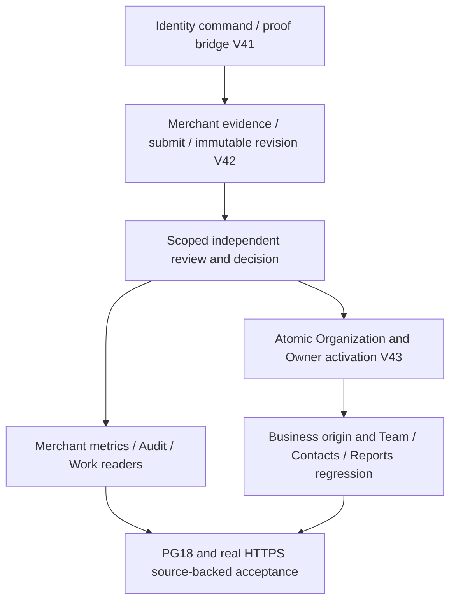

# Administration Console — P0 contract readiness

Ngày đối chiếu: 2026-11-23. Baseline `248d651951a1d3f70a5d15e73ccfa76b9877993d`,
branch `feature/argopost-admin-dashboard`. **CONTRACT REVIEW REQUIRED** cho authority
mới; không tuyên bố Merchant Approval hoặc toàn bộ ADM-01–23 FUNCTIONAL READY.

## Kết quả checkpoint

- [x] P0-01: bảo toàn WIP, đọc authority/DoR và đối chiếu canonical source.
- [x] P0-02: xác định Identity/context và xung đột role; không mở linking.
- [x] P0-03: thiết kế bounded Merchant Application → independent decision → atomic activation.
- [x] P0-04: đặc tả metric/scope và minimum supporting readers.
- [x] P0-05: cải tiến READ/UI trong contract hiện hữu, có test thực.
- [x] P0-06: cập nhật manifest và coverage của đủ23 module.
- [ ] P0-07: Owner duyệt exact manifest mới và các amendment/policy bên dưới.
- [ ] P0-08: triển khai authority mới và chứng minh P0-T-01–15 trên PG18/HTTPS.

Các mục thiết kế đã hoàn tất không phải acceptance của nghiệp vụ chưa triển khai.
Execution evidence và failure history nằm tại
[báo cáo source/test](admin-p0-implementation-execution.md).

## Nguồn và các phát hiện quyết định thiết kế

Hai DOCX19/27 trang được đối chiếu toàn bộ nội dung trích xuất trong checkpoint
restructuring; fingerprint và giới hạn tài liệu tham chiếu có trong
[báo cáo trước](admin-console-implementation-execution.md).
Tài liệu35 trang chỉ có crosswalk trích trong DOCX B, không nhận là đã đọc bản gốc.
DoR, account-first decision, Spec003 canonical/planning contracts và code thực tế
được đối chiếu; proposal cũ không tự trở thành API đã triển khai.

| Finding | Bằng chứng source | Disposition |
|---|---|---|
| V14 chỉ lưu DRAFT/current_revision1 | `V14__merchant_application_drafts.sql:6,35,42`; `MerchantApplicationDraft.view()` | Không đếm là Submitted; forward workflow/revision guard và startup compatibility gate |
| Input legal name240 nhưng Organization name160 | `MerchantApplicationDraft.java:19`; `V23__local_business_workspace_access.sql:3` | MA-COMPAT-01: giữ legal name; submit/resubmit khai báo display name riêng, không truncate |
| Organization chỉ có origin LOCAL_OPERATOR_PROVISIONED | V23:5; `JdbcBusinessWorkspaces.java:41`; `JdbcOrganizationTeam.java:163`; V28 export guard/V29 contact_scope | V43 proposal đổi đúng origin predicates và thêm activation binding; không relabel NamShop |
| Runtime không được tự tạo Initial Owner | V23 workspace guards và V34 Team guards | Chỉ đề xuất nhánh activation receipt-backed; giữ Initial/last Owner, Team và grant invariants |
| Admin admission chỉ chấp nhận6 READ; dedicated SYSTEM, không Root/Customer/Staff | `AdminSessionPolicy.java:32–42`; `JdbcAdminAdmission` | Không nới Identity grant allowlist; Merchant-owned scoped authority riêng cần duyệt |
| BUSINESS_CONTACT purpose tồn tại nhưng thiếu application attestation workflow | V8 customer_proof; không có implemented business-contact request/confirm adapter | Reuse proof/security/delivery, thêm đúng binding/attestation; không fake email_verified |
| Private bytes/scanning đã có, application evidence metadata chưa có | Platform `PrivateEvidenceStore`/`PrivateEvidenceScreening`; Merchant adapter alias | Reuse storage/scanner; thêm resource ownership/quota/immutable revision links; không dùng Claims ownership |
| Frontend parser từ chối field lạ | `src/admin/data.ts` strict projection | Metadata opt-in v2; default v1 giữ nguyên, không additive field vô điều kiện |
| R28–R32 trùng ID nhưng khác nghĩa giữa Matrix và Admin spec | [role reconciliation](admin-console-role-capability-mapping.md) | Documentary semantic keys; không đổi numeric IDs, không grant theo title |
| Existing IAM readers là Root/management realm-scoped | IdentityAdministrationCommands/ProductionIdentityReads | Không mở directory Staff/Customer hoặc IAM cho Admin READ |

## Identity, role và context resolution

[Identity/context contract](admin-p0-identity-context-contract.proposed.md) chốt
P0 không cần linking. Shared UI được dùng lại, từng portal vẫn có admission/session
độc lập; switcher không chuyển authority. Defer IWA-01 generic discovery API và
IWA-02 cross-context admission đến khi có linking policy riêng.

ROLE-P0-01 đề xuất semantic keys ADMIN_BUSINESS_GOVERNANCE,
ADMIN_PLATFORM_GOVERNANCE, ADMIN_IDENTITY_SECURITY, ADMIN_TECHNICAL_OPERATIONS,
ADMIN_SCOPED_AUDITOR. Đây là vocabulary/version cho tài liệu, không runtime role
templates. R28–R32 lịch sử không đổi nghĩa. Không cần data migration role IDs.

ID-P0-03/04 đề xuất command admission do Identity sở hữu, current session/subject
locks, purpose-bound step-up và Merchant-owned POLICY/ORGANIZATION assignments.
Không thêm Identity grant code, không Root shortcut, không grant union. Technical
Admin không tự nhận Finance/PII; KYC cần application.evidence.read riêng.

## Merchant Application và Activation

[Exact workflow design](admin-p0-merchant-approval-contract.proposed.md) và JSON
manifest là một gói; chưa có Backend/schema mới được viết.

1. Verified Customer hoàn thiện Draft, genuine business-contact proof, screened
   evidence và consent có nội dung/version thật; submit đóng băng revision.
2. Reviewer được phân công đúng policy, ghi checklist hoặc Request Information.
   Customer chỉ sửa working buffer được phép rồi resubmit thành revision mới.
3. Decider độc lập kiểm tra current authority, version, evidence/revision, business
   key, eligibility/conflict và step-up trước approve/reject.
4. Một local transaction commit APPROVED + Organization ACTIVE + đúng một Initial
   Owner + dashboard.read + registry + audit/receipt + delivery intent. Failure ở
   bất kỳ bước nào rollback; replay trả outcome cũ, không tạo Org/mail thứ hai.
5. Organization lifecycle P0 chỉ ACTIVE↔SUSPENDED cho origin APPLICATION_APPROVED,
   có quyền/step-up/audit. Closure, restricted state, owner transfer và financial
   clearance tiếp tục ngoài phạm vi.

Các quyết định **mới, cần duyệt rõ trong cùng checkpoint**:

| ID | Nội dung proposal |
|---|---|
| ID-P0-04 | Dedicated SYSTEM Admin chỉ review/decide khi có Merchant assignment do independent operator cấp |
| MA-POL-01 | Bounded Local/Test MANUAL_SANDBOX policy; COMPANY/HOUSEHOLD_BUSINESS; evidence/contact/consent prerequisites |
| MA-POL-02 | Hai người riêng biệt reviewer/decider cho mọi decision sandbox, không tự suy diễn threshold rủi ro |
| MA-POL-03 | Initial Owner chỉ nhận đúng dashboard.read; không booking/Finance/Team tự động |
| MA-POL-04 | Legacy Organization chưa có authoritative legal key chặn activation; không backfill/clearance override |
| MA-COMPAT-01 | SubmissionInput.organizationDisplayName1..160; legal registeredName240 giữ nguyên |
| MET/SCOPE-P0 | Opt-in metric v2, POLICY/ORGANIZATION scopes và snapshot fingerprint; không giả region/SIM |

Exact policy/jurisdiction dataset và Terms/Privacy text/version chưa được phê duyệt
không được seed ACTIVE hoặc dùng văn bản giả. Đây là deployment prerequisite;
isolated source/tests sau approval được dùng synthetic fixtures có nhãn rõ.
Legacy NamShop không tự được coi đã cleared và không được thay đổi trong task này.

## Dashboard và supporting capabilities

[Metric/read design](admin-p0-dashboard-supporting-read-contract.proposed.md):

- Giữ6 GET paths và default v1; metadata v2 opt-in, definition version, numerator/
  denominator, sample count, source event vs checked-at và effective scope version.
- Merchant metrics dùng firstSubmittedAt cohort và distinct application ID; không
  đếm mỗi revision. Processing chỉ dùng APPROVED/REJECTED samples đã commit.
- Booking/Parcel/confirmed fee/UNPAID giữ canonical cohort, không nhân tiền theo
  Parcel/event join; UNPAID không phải revenue, quá hạn hay tiền đã thu.
- ADM-08: existing list dùng được; masked same-snapshot detail là proposal, không
  gọi Customer detail để lách quyền hoặc mở private label/POD.
- ADM-12: reuse đúng Root IAM readers; general Staff governance vẫn thiếu authority.
- ADM-16: proposal Audit Explorer chỉ Merchant governance events, không global SQL
  explorer hoặc PII export.
- ADM-17: proposal Work Inbox derive từ submission/assignment/revision/decision-ready
  event thực; không tạo ApprovalTask giả hoặc nút mark complete thay approve.

Merchant Queue/Decisions hiện tiếp tục UNAVAILABLE; Network/SLA/COD/settlement và
telemetry chưa có canonical source cũng không đổi thành số0 hoặc seeded KPI.

## Một checkpoint phê duyệt kỹ thuật

Artifact: [admin-p0-implementation-manifest.proposed.json](admin-p0-implementation-manifest.proposed.json).
Hash chính xác và inventory được ghi dưới đây sau validation. Tất cả mục mới là
PROPOSED, P0-T-01–15 NOT_RUN_NOT_IMPLEMENTED. Source/test approval không đồng nghĩa
exact-target deployment, operator membership, policy publication hoặc real grants.

P0-READ Shipment detail không cần chờ activation schema nhưng vẫn cần duyệt API/DTO
mới. MET metadata không cần database table; không tạo MetricDefinition hoặc task
engine chỉ vì tiện implementation. Rollback giữ dữ liệu/history; disable writes,
dùng build tương thích hoặc forward fix, không sửa migration cũ/Flyway repair.

## Coverage và giới hạn kết luận

[Coverage ADM-01–23](admin-console-functional-coverage.csv) giữ đủ23 module,9 parent
groups và yêu cầu nguồn A/B. Phân loại không tăng nhờ proposal:8 PARTIAL,5 BLOCKED,
3 UNAVAILABLE,1 MISSING,6 PROPOSED, **0 module fully complete**. New P0 design refs
được gắn đúng ADM-01/02/03/08/12/16/17. READ/UI source slice đã kiểm chứng riêng;
Merchant submission/decision/activation chưa có runtime/test acceptance mới.

Hành động Owner tiếp theo duy nhất: duyệt hoặc nêu exact delta cho consolidated
manifest cùng các amendment/policy ở bảng trên để triển khai source/test P0.

## Exact manifest inventory

SHA-256: `90c795bd7e773b6a58d0d220056cfbc5e9a5ee95b38ae2493d5b9f75a372291f`.

| Surface | Count / exact inventory |
|---|---|
| API records |32:31 new method/path pairs +1 extension of existing onboarding-receipts; six existing Dashboard paths changed opt-in only |
| DTO inventory |49 named existing/changed/new projections; field contracts and bounds in JSON |
| Interfaces |7 proposed public domain ports; no imports of another module internal package |
| Permissions |10 Merchant-owned capabilities,0 new Identity codes or runtime role templates |
| Database |15 proposed tables,9 bounded existing-object amendments;0 migration files created |
| SQL / privileged setup |5 exact function signatures;2 proposed NOLOGIN roles, no runtime membership |
| Migration candidates |V41 Identity -> V42 review -> V43 activation; recheck stream before implementation |
| Tests |P0-T-01 through P0-T-15 NOT_RUN_NOT_IMPLEMENTED |

### API review index -> all PROPOSED

| ID | Method / path | Request -> response | Permission / scope |
|---|---|---|---|
|P0-CUST-01|`POST /api/v1/merchant-applications/{applicationId}/submit`|SubmissionInput -> Application|SELF / current eligible applicant|
|P0-CUST-02|`POST /api/v1/merchant-applications/{applicationId}/resubmit`|SubmissionInput -> Application|SELF / current eligible applicant|
|P0-CUST-03|`POST /api/v1/merchant-applications/{applicationId}/withdrawal`|ReasonInput -> Application|SELF / current eligible applicant|
|P0-CUST-04|`POST /api/v1/customer/business-contact-proofs`|BusinessContactRequest -> ProofAccepted|SELF / owned application + current Customer session|
|P0-CUST-05|`POST /api/v1/customer/business-contact-confirmations`|BusinessContactConfirmation -> BusinessContactAttestation|SELF / same application/subject/proof/session|
|P0-CUST-06|`POST /api/v1/merchant-applications/{applicationId}/evidence`|EvidenceUpload -> Evidence|SELF / owned editable application|
|P0-CUST-07|`GET /api/v1/merchant-applications/{applicationId}/evidence/{evidenceId}`|none -> Evidence|SELF / owned application|
|P0-CUST-08|`GET /api/v1/merchant-applications/{applicationId}/evidence/{evidenceId}/content`|none -> BINARY|SELF / owned application|
|P0-CUST-09|`DELETE /api/v1/merchant-applications/{applicationId}/evidence/{evidenceId}`|none -> no body|SELF / unsubmitted working evidence only|
|P0-CUST-10|`GET /api/v1/onboarding-receipts/{operationId}/{idempotencyKey}`|none -> CommandReceipt|SELF / existing path, additive finite workflow operations only|
|P0-ID-API-01|`POST /api/v1/admin/governance-reauthentications`|AdminStepUpInput -> StepUpResult|ADMIN_DASHBOARD_READ + current requested Merchant capability / current dedicated SYSTEM Admin/session/target|
|P0-GOV-01|`GET /api/v1/admin/merchant-governance/context`|none -> GovernanceContext|ADMIN_DASHBOARD_READ / current actor only|
|P0-GOV-02|`GET /api/v1/admin/merchant-applications`|ApplicationQuery -> ApplicationSummaryPage|ADMIN_MERCHANT_READ + application.read / published assigned policy scopes|
|P0-GOV-03|`GET /api/v1/admin/merchant-applications/{applicationId}`|none -> ApplicationSummary|ADMIN_MERCHANT_READ + application.read / target policy|
|P0-GOV-04|`GET /api/v1/admin/merchant-applications/{applicationId}/review-data`|ReviewDataQuery -> ReviewData|ADMIN_MERCHANT_READ + application.read + application.evidence.read / target policy; MERCHANT_REVIEW purpose; disclosure audit|
|P0-GOV-05|`POST /api/v1/admin/merchant-applications/{applicationId}/review-assignment`|ReviewerAssignmentInput -> ApplicationSummary|application.assign / current actor and eligible target reviewer policy intersection|
|P0-GOV-06|`POST /api/v1/admin/merchant-applications/{applicationId}/review`|ReviewInput -> ApplicationSummary|application.review / assigned reviewer, exact revision/policy|
|P0-GOV-07|`POST /api/v1/admin/merchant-applications/{applicationId}/request-information`|InformationRequest -> ApplicationSummary|application.review / assigned reviewer, exact revision|
|P0-GOV-08|`POST /api/v1/admin/merchant-applications/{applicationId}/approval`|DecisionInput -> ActivationOutcome|application.decide / independent decider, target policy, current step-up|
|P0-GOV-09|`POST /api/v1/admin/merchant-applications/{applicationId}/rejection`|DecisionInput -> ApplicationSummary|application.decide / independent decider, target policy, current step-up|
|P0-GOV-10|`GET /api/v1/admin/merchant-applications/{applicationId}/revisions`|PageQuery -> ApplicationRevisionPage|application.read / target policy; masked facts only|
|P0-GOV-11|`GET /api/v1/admin/merchant-applications/{applicationId}/events`|PageQuery -> AuditPage|audit.read / target policy, no raw protected payload|
|P0-GOV-12|`GET /api/v1/admin/merchant-applications/{applicationId}/evidence/{evidenceId}/content`|ReviewDataQuery -> BINARY|application.read + application.evidence.read / target policy, MERCHANT_REVIEW purpose, disclosure audit|
|P0-GOV-13|`GET /api/v1/admin/merchant-organizations`|OrganizationQuery -> OrganizationSummaryPage|org.read / explicit org or activation policy scope|
|P0-GOV-14|`GET /api/v1/admin/merchant-organizations/{organizationId}`|none -> OrganizationSummary|org.read / explicit org or activation policy scope|
|P0-GOV-15|`POST /api/v1/admin/merchant-organizations/{organizationId}/suspension`|LifecycleInput -> OrganizationSummary|org.suspend / APPLICATION_APPROVED origin only; step-up|
|P0-GOV-16|`POST /api/v1/admin/merchant-organizations/{organizationId}/reinstatement`|LifecycleInput -> OrganizationSummary|org.reinstate / APPLICATION_APPROVED origin only; step-up + current initial Owner|
|P0-GOV-17|`GET /api/v1/admin/merchant-governance/receipts/{operationId}/{idempotencyKey}`|none -> CommandReceipt|current permission for original operation / same actor/realm/target policy, no proof replay authority|
|P0-GOV-18|`GET /api/v1/admin/merchant-governance/reviewer-candidates`|ReviewerCandidateQuery -> ReviewerCandidatePage|ADMIN_MERCHANT_READ + application.assign / same policy; current dedicated Admin eligibility before pagination, no global account directory|
|P0-READ-01|`GET /api/v1/admin/shipments/{shipmentId}`|OversightQuery -> ShipmentOversight|ADMIN_SHIPMENT_READ / current admitted Local/Test realm + valid original contributing snapshot|
|P0-READ-02|`GET /api/v1/admin/audit`|AuditQuery -> AuditPage|audit.read / MERCHANT_APPLICATION or MERCHANT_ORGANIZATION only; assigned scope|
|P0-READ-03|`GET /api/v1/admin/work-items`|WorkQuery -> WorkPage|task.read + application.read / current policy and eligible assignment/independent-decision predicate|

Success/error, version/If-Match/idempotency, DTO fields, PK/FK/CHECK/unique and
operator privilege boundaries are normative in the linked JSON and three bounded
designs. This index is not a separate approval with a looser authority set.
