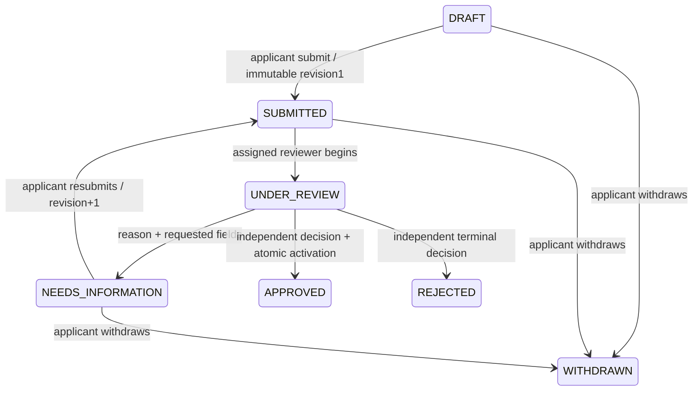

# P0 Merchant application, review and atomic activation

Status: **PROPOSED — NOT IMPLEMENTED**, 2026-11-23. Exact endpoint/DTO/table/SQL
inventory is in the [consolidated manifest](admin-p0-implementation-manifest.proposed.json).
No new permission, source schema or real reviewer has been created.

## Canonical owner and explicit compatibility deltas

Merchant owns application, immutable revisions, legal business key, review scopes,
decisions, Organization and Membership. Identity owns current principals, proofs,
credentials, step-up and physical admission transaction. Notifications owns
delivery, Platform owns private bytes/scanning, workflow composes public APIs.
Keep one Backend artifact and existing module boundaries.

| Current source | Actual limitation | Proposed controlled amendment |
|---|---|---|
| V14 application CHECK `state='DRAFT'`, current_revision=1 | No submission, review, decision or submitted snapshot | Forward V42 exact state/revision/guard changes; never edit V14 |
| MerchantApplicationDraft.view()/store | Always produces DRAFT, history FK points at draft versions | New workflow-aware projection; preserve old partial draft DTO, receipts and history; never parse a submitted row as a Draft |
| V23 Organization admission_origin | Only LOCAL_OPERATOR_PROVISIONED | Forward V43 admits APPLICATION_APPROVED only with valid activation/decision/revision binding; never relabel existing organizations |
| JdbcBusinessWorkspaces, JdbcOrganizationTeam | Queries hardcode operator origin | Amend both readers to a common Merchant-owned origin predicate, with same membership/permission checks |
| V28 orders.guard_report_export_audit; V29 merchant.contact_scope | DB guards hardcode operator origin too | V43 changes exactly these predicates with owning-domain review; no export/PII permission expansion |
| V34 workspace identity / initial Owner invariants | Runtime must not arbitrarily create/change Owner | Only an approved-activation receipt-backed insertion branch, preserve all old branches and terminal/lifecycle protections |
| Admin six READ admission | No business write authority | Separate domain assignment + proposed AdminCommandAdmission; no additional Identity grants |
| Draft registeredName allows240, Organization display_name/current Business DTO allow160 | A valid legal name cannot be truncated into an Organization name | MA-COMPAT-01: new submit/resubmit SubmissionInput carries organizationDisplayName1..160, frozen separately in the revision; preserve the full registeredName and old Draft DTO |

Existing Local operator functions stay operator-only, with unchanged signatures,
semantics and request receipts. Never call PROVISION from approval, inherit
operator privileges or impersonate the operator. Local/Test Origin is not legal
verification, a pricing contract, Carrier Acceptance or an approved commercial SLA.

## MA-POL-01 [PROPOSED]: bounded Local/Test policy

Reuse accepted POLICY-003-01 MANUAL_SANDBOX and privacy controls: COMPANY and
HOUSEHOLD_BUSINESS; declared issuing jurisdiction; legal/registered name and ID;
structured registered/operating address; representative name/email/relationship;
registration and representative-authorization documents; independently verified
business-contact attestation; explicit accuracy/representation and versioned
consent. Exact text/published version must exist before runtime submission opens.
Current missing Terms/Privacy approval is not faked by a placeholder checkbox.

No claim of government registry verification. No automatic geographic coverage
or Pickup capability derives from registered address. No tariff/COD/Finance grant
is created by approval. SLA/risk thresholds remain unconfigured, not guessed.

MA-POL-02 proposes **two-person sandbox decision review for every application**:
assigned reviewer completes a revision-bound checklist; another current scoped
decider approves/rejects. This is a stricter proposed policy, not an already
accepted risk-threshold implementation. It needs Owner approval in this package.
Unresolved conflict, ambiguous duplicate, missing evidence or declared risk hold
blocks approval; an internal comment does not clear a hold. No unsupported
high-risk override or amount-limit engine is included.

MA-POL-03 proposes an explicit minimal Owner activation grant set:
`dashboard.read` only. It is required by current Business admission and enables no
booking, Finance, team administration or contacts authority. More Merchant rights
are later independent exact grants. This set is part of approval, not automatic
inheritance of the existing Owner ceiling.

## MA-SM-01: state machine and snapshot ownership

Unlisted transitions deny, including withdrawal during review. RESUBMITTED is an
event/revision indicator, not another mutable state. NEW is an Inbox label, not
DRAFT disguised as a submission. DRAFT editing increments version; in
NEEDS_INFORMATION only the next working draft can change. Each submit freezes a
new complete revision/evidence set/policy/consent/contact fact; earlier revisions,
comments, decisions and reviewed digests remain immutable. Draft history is kept.

The existing V14 current-draft FK remains satisfied: each business-version change
also appends the exact working-buffer version, even when review did not edit it.
`current_revision` changes only on submission/resubmission; a nullable submitted
revision FK distinguishes a never-submitted Draft from submitted revision1.
Original Draft-command replay retains its historical outcome; the new UI rereads
the current canonical application after receipt recovery, rather than displaying
an old Draft as the current state.

MA-COMPAT-01 is an explicit proposed compatibility amendment: submit/resubmit
require `organizationDisplayName`1..160 characters, NFC and no control characters.
It can initially default to registeredName when that fits; otherwise Customer
enters a shorter display name. This does not change the legal identity or the old
Draft API. Review shows both names. Activation uses the immutable submitted display
name, not a mutable working buffer. Never truncate a240-character registered name
or widen the current Organization wire limit behind old clients.

For this single DB/artifact use the existing canonical **atomic approval** policy:
APPROVED is committed only together with Organization ACTIVE, exactly one initial
Owner, business key reservation, minimal grant, audit/receipt and delivery intent.
Do not introduce committed APPROVED-but-not-activated state or an unsafe retry
button. A transient failure rolls back the entire transaction; a lost response
resolves the original receipt. ACTIVATION_PENDING/remote saga requires a separate
future contract. UI may show Activation Outcome, but it reads persisted evidence.

## MA-TX-01: command protocol and concurrency

All mutations use canonical UUID Idempotency-Key; target mutations require strong
If-Match `"vN"`. Reject unknown/duplicate JSON/query/header fields and unsupported
content types. Actor, owner, Organization IDs and scope are not client inputs to
approval. Versions increase exactly1 per successful command. No unversioned PATCH
status or arbitrary transition endpoint.

Lock order: existing Identity population lock → sorted referenced subjects →
sessions → Merchant control lock → published policy/reviewer scopes → sorted
Organizations → old/new business keys → application/assignment/revision/evidence →
receipts. Discover applicant/assignee references through a public read port first;
Identity locks them, Merchant rereads and compares before mutation. A changed
reference denies, never locks a late unverified account inside Merchant SQL.

Before business mutation check current admission, current published policy and
assignment, target scope, known conflicts, current applicant eligibility, version,
state and immutable revision/digests. Resolve committed same-key receipt before
stale ETag/consumed step-up checks; current authorization and target visibility
still precede replay. Exact actor/realm/operation/target/input digest must match.
Different payload409, no extra mutation/audit/mail on replay. Revoke committed
first denies later command/replay; valid earlier commit stays committed.

Approval rechecks registered business-key uniqueness under lock and requires
reviewer != decider != applicant; neither reviewer nor decider may have a known
related Merchant membership/ownership or an unresolved declared conflict. The
offline scope-granting operator cannot decide their own related application.
Do not claim detection of undisclosed off-platform relationships.

Generate Organization/Membership UUIDs server-side within the transaction; derive
Owner from locked applicant. Insert activation binding with real composite FKs;
deferred constraints require APPROVED↔activation↔key registry↔Organization↔initial
Owner↔decision consistency at commit. Runtime direct writes without complete
valid evidence fail. No runtime DELETE of application/audit/receipt/activation or
grant-widening path. Runtime is not a schema owner, operator or NOLOGIN writer.

## MA-DUP-01: duplicates and existing operator-created organizations

Reuse V14 NFC/jurisdiction/entity/legal-key normalization; preserve original text.
One active application per exact normalized key, one activated Organization per
registered key, including historical aliases. Reject collision without revealing
another applicant's legal data; never merge Organizations or replace an Owner.

Existing operator-created Organizations have no authoritative legal business key.
Do not invent/backfill one from display name or account email. MA-POL-04 proposes
fail-closed deployment: approval remains disabled if any in-scope legacy
Organization has no authoritative registered legal key. This package does not
implement legacy-key backfill or a clearance override boolean; those require a
later exact mapping/technical contract. It cannot declare NamShop Demo cleared.
Fresh isolated activation tests have no legacy operator-created Organization.
Fresh isolated tests cover both clean-empty and unresolved-legacy branches.

## MA-EVID-01: genuine proof/evidence dependency

Identity already permits BUSINESS_CONTACT purpose in V8, but no implemented
business-contact API/attestation adapter was found. Reuse its15-minute subject/
session/authVersion-bound proof and protected delivery, not Customer enrollment
OTP or Merchant-owned email_verified flag. New request/confirm bindings include
the owned application UUID; receipt replay and resource checks are explicit.

Attestation must be current/unrevoked at submission and consumed for that exact
revision. Its verified-at fact is frozen; ordinary passage of its proof TTL after
submission does not make every queued application impossible to review. Approval
rechecks current applicant eligibility, unchanged submitted contact binding and
any security revocation; material contact/representation changes require a new
revision/proof. No security-email change follows from business verification.

PDF/PNG/JPEG,5MiB each, at most5 retained/reserved files per application; no clean
verdict from file extension. Reserve quota in a bounded DB transaction, upload and
inspect via existing Platform ports outside it, then current-owner/size/MIME/hash/
reservation recheck and finalize in another owned transaction. Failures leave
quarantine/retry evidence, never CLEAN metadata for missing bytes. No new storage
provider; reuse private S3/filesystem/scanner contracts. Version/content signatures
and scan verdict enter submitted snapshot. Reviewer download requires its separate
evidence permission, current scope and redacted disclosure event; no public URL.

Archived draft evidence remains retained, not physically deleted. Submitted
evidence cannot be removed or overwritten. Sandbox retention defaults remain
those already approved; destructive purge, legal-hold release and production
retention remain disabled. New Claims evidence is not repurposed across owners.

## MA-LIFE-01: bounded Organization lifecycle

P0 directory/detail reads use authoritative approved application/activation and
membership summary, masked legal/contact fields. Suspended/active transitions are
proposed only for APPLICATION_APPROVED Organizations in scope, with step-up,
expected version, reason, audit and receipt. Suspension immediately blocks current
Business admission without deleting Identity, Personal access, Shipment or ledger.
Resume requires current valid initial Owner and no active hold. Recheck Team,
Shipping, Contacts, Reports and Support readers/guards; origin support is not a
permission grant.

RESTRICTED/CLOSURE_REQUESTED/CLOSED, owner transfer/recovery, legal-key changes and
financial clearances are explicitly deferred: no authoritative coordinated Orders/
Finance/Claims clearance exists. This P0 does not complete all ADM-03 capabilities.
Missing clearance is UNKNOWN, never zero. No modification of operator-created
NamShop Demo through the new lifecycle command path.

## Compatibility, migration and rollback

V41/V42/V43 are unoccupied candidates at this preflight only; no SQL file exists or
number is permanently reserved. Recheck stream before implementation. Preserve
39 existing file bytes, old receipts, grants, versions and data. Add new tables and
controlled forward constraint/function replacements only after manifest approval.

V14 old projection always says DRAFT, so do **not** claim mixed-version compatibility
after submission. V42 replaces the application trigger with a versioned name;
updated startup checks understand it, old V14-only startup check fails closed.
Upgrade all business API readers before enabling submit. Existing DRAFT wire and
its receipts keep exact shape/behavior; new workflow responses are version-aware.
Disable new writes/reads before rollback; retain schema/history and use a compatible
build or forward fix. No Flyway repair/down migration or restoration over live data.

A new no-login writer/operator setup is a proposed privileged prerequisite, never
executed by Flyway NOCREATEROLE or runtime. Exact operator membership, physical
environment binding, policy publication and runtime activation require separate
deployment approval after source/test acceptance. Defaults remain disabled.

## Acceptance required after technical approval

Isolated PG18 migrations/constraints/ACL/direct-DML denial; actual Customer submit
from a complete Draft with real test-mail proof and screened private fixture;
resubmit immutable revisions; cross-applicant and cross-policy denial; independent
reviewer/decider; stale ETag and revoke races; exact-key replay/lost response;
approve/reject concurrency; rollback at each activation write; exactly one Org/
Owner/receipt/mail; rejected/withdrawn terminal protection; suspension/reinstatement
and Personal/Team/Business regression. Real HTTPS Browser must exercise actual
new endpoints. A declarative manifest validator is not this functionality.
