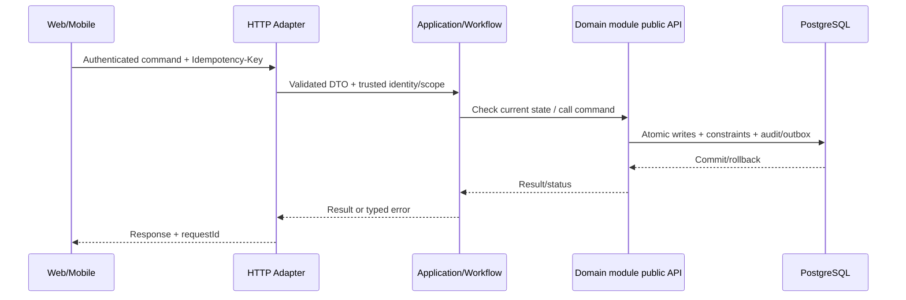

# Technical Design 001: Nền tảng repository, deploy và kiến trúc

**D1-05 implemented CI slice (2026-10-14):** approved task scope adds Linux
GitHub Actions PR→develop/push develop with separate architecture/default-H2/PG18
jobs, isolated Maven settings/cache, exact Surefire discovery checks and sanitized
artifacts. PostgreSQL image and role/schema policy match D1-03; fresh tmpfs test
container/database/upgrade database are provisioned per job without dev volumes.
Existing V1/V2, POM, production architecture and HTTP contracts are unchanged.
Local Linux execution PASS; actual GitHub Actions/required checks UNVERIFIED,
full feature still PARTIAL. [CI guide](../../docs/quality/ci-verification.md),
[evidence](../../docs/implementation/d1-05-ci-evidence.md).

**State:** DESIGN_PROPOSED — không mô tả API/migration đã implement.  

**D1-03 DB milestone accepted/implemented 2026-10-13:** DEC-26 approved explicitly; PostgreSQL 18.6 isolated dev container/5433, nine ownership schemas, V1/V2 global stream, platform history, owner/migrator/runtime roles and local/test migrations/shared job implemented. Demo-001 real PostgreSQL tests/migration/permissions/restart/browser checks PASS; H2 remains intact. This subsection records only the approved DB slice; remaining proposed contracts/feature AC are unchanged. [ADR](../../docs/architecture/decisions/ADR-0002-database-ownership.md), [evidence](../../docs/implementation/d1-03-postgresql-evidence.md). D1-03/full foundation still PARTIAL.
**Source:** `spec.md`, `docs/architecture/*`, [REPORT] Chương 3–4.

**D1-04 approved local architecture slice, 2026-10-14:** ArchUnit core 1.5.1
test-scope/plain Jupiter, real root `com.elogistic.backend`, implemented packages
identity/merchant/orders/platform. Ten architecture rules plus scope guards and
isolated effectiveness fixtures PASS; six remaining business modules have no
implementation/verification claim. Internal application ports invert persistence
coupling; technical seeds stay in infrastructure. Orders accepts only minimal
`identity.api.AuthenticatedActor` at web/application boundary, populated from the
existing DB-validated security principal. No domain-to-Identity or broad AccountView
dependency. User approved this collaboration/refactor explicitly; original HTTP
JSON, RBAC, ownership, transactions and migrations unchanged.
[ADR-0004](../../docs/architecture/decisions/ADR-0004-architecture-verification.md),
[evidence](../../docs/implementation/d1-04-architecture-evidence.md).
Local verification does not complete CI/full REQ-001-03 or the full feature DoD.

## 1. Bounded context / code location
- Primary owner: `platform, workflow; all module skeletons`.
- Backend: `apps/backend/src/main/java/com/example/elogistics/<module>/api/` và `internal/{web,application,domain,infrastructure}/`.
- Application coordination xuyên module chỉ ở `workflow`, gọi public contracts; không truy cập trực tiếp `othermodule.internal`.
- Web: `apps/web/src/features/platform-foundation/` khi có màn hình liên quan. Mobile: `apps/shipper-mobile/src/features/platform-foundation/` nếu shipper thao tác.

## 2. Domain model & persistence boundary
Schema nine ownership + audit/technical helpers khi cần; migration table; health/readiness; demo seed tách khỏi migration.

**Database rules:** owner schema; foreign/unique/check/conditional update theo `docs/architecture/data-ownership.md`; append-only cho ledger/stock movement/tracking/audit; migration mới thay vì ORM auto-DDL. Không tạo bảng cho dữ liệu chưa có use case.

## 3. Public API proposal — cần đưa vào OpenAPI sau review
GET /actuator/health (hoặc endpoint tương đương); GET /api/v1/meta nếu cần; **không** công khai endpoint debug chứa config.

- `Authorization`: role + scope + ownership theo FR/BR; request owner ID không phải nguồn đáng tin.
- Mutation dùng `Idempotency-Key` ở điểm có tác động, `X-Request-Id` để correlate; DTO được validate, lỗi có stable `error.code`.
- Trạng thái gợi ý: `201` create, `200` query/commit, `202` deferred/unknown, `400/422` invalid input/business, `401/403/404` auth, `409` duplicate/state, `503` dependency; cụ thể hóa tại `contracts/openapi/`.
- Không trả toàn bộ persistence entity/JPA object; output use case DTO tối thiểu.

## 4. Data flow / transaction boundary

**Feature-specific atomicity:** Không transaction nghiệp vụ; migration atomic theo hỗ trợ PostgreSQL; seed idempotent theo định danh.

## 5. Events, async / retry
Không phát event từ skeleton; chuẩn bị Outbox/Inbox contract chưa triển khai consumer nếu chưa cần.

- Với event thật: versioned envelope `eventId`, `eventType`, `version`, `aggregateId`, `occurredAt`, `correlationId`, minimal payload; outbox commit cùng source; consumer inbox idempotent.
- Retry bounded/backoff và failed job state; callback/scan được dedupe theo business scope, không tin RabbitMQ bảo đảm exactly-once.

## 6. Lỗi / bảo mật / UI state
- **Failure semantics:** Thiếu biến môi trường bắt buộc phải fail-fast có hướng dẫn; Redis down không được báo quote sai; migration lỗi không khởi chạy API nhận ghi.
- **AuthZ:** enforce tại server theo actor và object, bao gồm read, update và async recovery.
- **UI:** loading/success/validation conflict/pending-verification/offline states (chỉ khi phù hợp); giữ input khi request lỗi; optimistic UI không thay business truth.
- **Audit & privacy:** lưu actor + target + trace + reason cho operation nhạy cảm; mask token, PII, GPS và payment key trong log.

## 7. Kiểm thử kỹ thuật (thiết kế trước khi code)
Maven clean verify, module boundaries, Testcontainers Flyway cold-start, Compose smoke, web build/typecheck, mobile development build feasibility.

| Loại test | Bảo đảm |
| --- | --- |
| Unit `TEST-001-UNIT-*` | REQ, guard, edge state |
| Integration `TEST-001-INT-*` | Postgres transaction/constraint, owner boundary, API |
| Concurrency `TEST-001-CONC-*` | Zero duplicate effects, invariant under interleaving |
| E2E `TEST-001-E2E-*` | User journey, pending/conflict/error UX |
| Fault `TEST-001-FAULT-*` | Timeout/retry/crash + recovery states |

## 8. Interfaces & dependencies
Feature prerequisites: foundation bootstrap. Không thêm call cycle; nếu thiếu contract, tạo/duyệt public interface trước khi implement service.

## 9. Security/performance/operability
- Đo metric theo NFR liên quan NFR-O01, NFR-O02, NFR-O03, NFR-M01, NFR-M02 và tên operation.
- Load benchmark không tạo số liệu giả; dùng cùng seed/fixture và môi trường được công bố.
- Test RBAC/tenant scoping và no token/log sensitive data.

## 10. Decisions to close before implementation
[BLOCKING] Khóa phiên bản Spring/Modulith/Node/Expo, auth approach, provider storage/map; phụ thuộc nền tảng nào chưa chốt cần spike và ADR.

Mọi endpoint/tên bảng/field mới trong tài liệu là **[PROPOSED]**; báo cáo không định nghĩa đầy đủ API/migration. Sau khi duyệt, khóa hợp đồng ở `contracts/openapi/` và ghi ADR khi quyết định mang tính kiến trúc.
