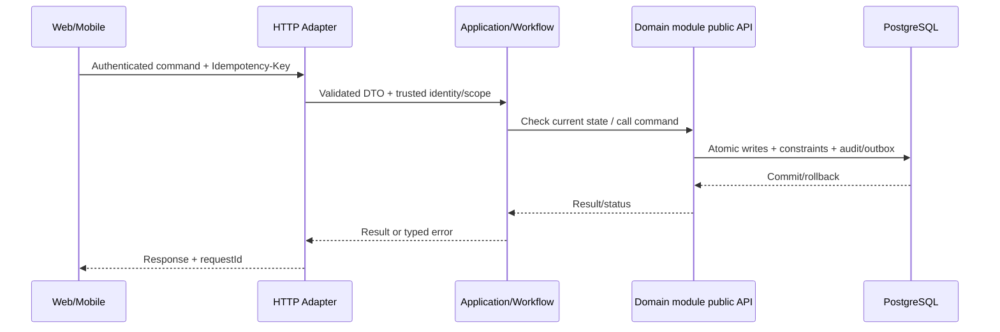

# Technical Design 002: Xác thực và phân quyền theo phạm vi

**State:** DESIGN_PROPOSED — không mô tả API/migration đã implement.  
**Source:** `spec.md`, `docs/architecture/*`, [REPORT] Chương 3–4.

## 1. Bounded context / code location
- Primary owner: `identity`.
- Backend: `apps/backend/src/main/java/com/example/elogistics/<module>/api/` và `internal/{web,application,domain,infrastructure}/`.
- Application coordination xuyên module chỉ ở `workflow`, gọi public contracts; không truy cập trực tiếp `othermodule.internal`.
- Web: `apps/web/src/features/identity-access/` khi có màn hình liên quan. Mobile: `apps/shipper-mobile/src/features/identity-access/` nếu shipper thao tác.

## 2. Domain model & persistence boundary
identity.user_account, credential/session, roles, permissions, scopes, audit trail; FK chỉ qua public IDs.

**Database rules:** owner schema; foreign/unique/check/conditional update theo `docs/architecture/data-ownership.md`; append-only cho ledger/stock movement/tracking/audit; migration mới thay vì ORM auto-DDL. Không tạo bảng cho dữ liệu chưa có use case.

## 3. Public API proposal — cần đưa vào OpenAPI sau review
POST /api/v1/auth/login; POST /api/v1/auth/logout; POST /api/v1/auth/refresh [nếu chọn token]; GET /api/v1/auth/me; Admin /api/v1/admin/users và /scopes.

- `Authorization`: role + scope + ownership theo FR/BR; request owner ID không phải nguồn đáng tin.
- Mutation dùng `Idempotency-Key` ở điểm có tác động, `X-Request-Id` để correlate; DTO được validate, lỗi có stable `error.code`.
- Trạng thái gợi ý: `201` create, `200` query/commit, `202` deferred/unknown, `400/422` invalid input/business, `401/403/404` auth, `409` duplicate/state, `503` dependency; cụ thể hóa tại `contracts/openapi/`.
- Không trả toàn bộ persistence entity/JPA object; output use case DTO tối thiểu.

## 4. Data flow / transaction boundary

**Feature-specific atomicity:** Role update/assignment and audit trong một transaction của identity; không update bảng order/finance.

## 5. Events, async / retry
AccountDisabled/PermissionChanged công khai tối thiểu nếu có subscriber; không chứa token hoặc password.

- Với event thật: versioned envelope `eventId`, `eventType`, `version`, `aggregateId`, `occurredAt`, `correlationId`, minimal payload; outbox commit cùng source; consumer inbox idempotent.
- Retry bounded/backoff và failed job state; callback/scan được dedupe theo business scope, không tin RabbitMQ bảo đảm exactly-once.

## 6. Lỗi / bảo mật / UI state
- **Failure semantics:** User không đăng nhập/phiên hết hạn bị từ chối; merchant A không đọc B; shipper không thể tự nâng quyền; admin không tự duyệt nộp COD.
- **AuthZ:** enforce tại server theo actor và object, bao gồm read, update và async recovery.
- **UI:** loading/success/validation conflict/pending-verification/offline states (chỉ khi phù hợp); giữ input khi request lỗi; optimistic UI không thay business truth.
- **Audit & privacy:** lưu actor + target + trace + reason cho operation nhạy cảm; mask token, PII, GPS và payment key trong log.

## 7. Kiểm thử kỹ thuật (thiết kế trước khi code)
Domain role matrix, API 401/403/404, cross-tenant object integration, revoked token, session expiry, auth rate-limit and logs.

| Loại test | Bảo đảm |
| --- | --- |
| Unit `TEST-002-UNIT-*` | REQ, guard, edge state |
| Integration `TEST-002-INT-*` | Postgres transaction/constraint, owner boundary, API |
| Concurrency `TEST-002-CONC-*` | Zero duplicate effects, invariant under interleaving |
| E2E `TEST-002-E2E-*` | User journey, pending/conflict/error UX |
| Fault `TEST-002-FAULT-*` | Timeout/retry/crash + recovery states |

## 8. Interfaces & dependencies
Feature prerequisites: 001. Không thêm call cycle; nếu thiếu contract, tạo/duyệt public interface trước khi implement service.

## 9. Security/performance/operability
- Đo metric theo NFR liên quan NFR-S01, NFR-S02, NFR-S04 và tên operation.
- Load benchmark không tạo số liệu giả; dùng cùng seed/fixture và môi trường được công bố.
- Test RBAC/tenant scoping và no token/log sensitive data.

## 10. Decisions to close before implementation
[BLOCKING] Session cookie hay access+refresh token, vòng đời token, reset password qua mail sandbox, đăng ký account công khai hay chỉ admin cấp?

Mọi endpoint/tên bảng/field mới trong tài liệu là **[PROPOSED]**; báo cáo không định nghĩa đầy đủ API/migration. Sau khi duyệt, khóa hợp đồng ở `contracts/openapi/` và ghi ADR khi quyết định mang tính kiến trúc.

## 2026-10-20 — reconstructed Production Identity decision baseline

[ADR-0009](../../docs/architecture/decisions/ADR-0009-production-identity-lifecycle.md) records freshly reaffirmed DEC-03/04 and bounded O1–O7. This supplement supersedes section10's unresolved browser authentication choice for this scope only; original REQ/AC and historical proposal text are preserved.
T-002-01 DONE for browser design-decision scope; production implementation and AC remain pending. Actual package root is app/backend/src/main/java/com/elogistic/backend/identity; earlier apps/com.example paths are historical proposals, not current source.

[Reconstructed contract](../../contracts/openapi/identity-access.yaml), [semantics](../../contracts/identity-access/README.md), [fresh evidence](../../docs/implementation/t-002-02-identity-contract-evidence.md), [supplemental trace](../../docs/quality/feature-002-recovery-traceability.md).
T-002-02 is CONTRACT_REVIEW_PENDING until schema/fixture/security/strict lint and focused candidate review gates are all satisfied. No original implementation AC is accepted by contract tests. Production code/data model is NOT IMPLEMENTED.

Identity-only /api/v1 objects and flat stable errors do not promote global DEC-25. All target/grant-union authority, last-admin serialization, revocation, audit and receipt atomicity must be proved by later PostgreSQL integration/concurrency tests. JSON examples and declared effects do not provide those proofs.
Remaining implementation decisions: deployment bootstrap/secret operations, production mail provider, mobile transport, authority integration availability, retention/rate-limit configs. Default deny and sandbox-only policies remain mandatory. No mobile/production-email completeness claimed. T-002-03 stays blocked on T-002-02 acceptance and approved data model.

## T-002-02 final technical acceptance — 2026-10-21

OWNER_T_002_02_FINAL_VERIFICATION_APPROVAL authorizes focused contract review/corrections and acceptance. T-002-02 DONE for exact OpenAPI SHA-256 acf92380c325698a1370a2ade6accff82bb338c4524f6328a9613d3e4b7b6128:512 fresh contract checks (43 document mutation controls included) and one Linux Redocly2.64.0 strict lint, exit0/zero errors/warnings/ignored. Prior review-pending state above is historical. No canonical REQ/AC text, accepted ADR or global DEC-25 change.
Logout now permits an absent refresh cookie after successful logout, while always requiring server-bound CSRF and exact Origin; family binding remains required when refresh cookie is supplied. Recovery receipt scope is server-preauth/operation/key, equal for eligible/ineligible inputs; delivery authority is stored verified email, never arbitrary submitted email. [Full findings, evidence and migration handoff](../../docs/implementation/t-002-02-identity-contract-evidence.md#t-002-02-final-review-and-acceptance-2026-10-21).
21 original behavioral expectations plus4 logout case declarations remain future HTTP/PostgreSQL/runtime acceptance, not tested effects. Supplemental traceability is explicitly authorized for this task; main Foundation traceability stays protected. Feature002 and AC-002-01..05 remain unaccepted; T-002-03 is next only under separate implementation authorization.

## T-002-05 bounded invitation activation application ? 2026-10-23

[Implementation checkpoint](../../docs/implementation/t-002-05-invitation-activation-evidence.md)
records owner-approved Application source, not new HTTP/wire behavior. Internal
command carries proof locator, owned token buffer, exact password and operation/
correlation IDs. Proof locator is never authority; existing HMAC with retained
key, current pending account/exact grant/destination/ACTIVE Realm admit only the
ordinary provisioned target. Resolving accepted HTTP token/password to proof
context remains T-002-06; no new request field/envelope is introduced here.
Reuse existing Domain activate/password policy and Identity transaction lock.
Password, proof, account/versions, revocation, audit, receipt and matching obsolete
outbox payload clearing commit atomically; exact authorized same-key replay is a
no-op. Keyed fingerprint uses a new explicit HMAC purpose separator under the
proof's retained verifier key; it is never a plaintext/unkeyed password digest.
No external I/O or session issuance. Runtime role has no Realm UPDATE/bootstrap
privilege; inactive bootstrap flow remains separate and fails closed here.
Production composition is explicit/unregistered with externally supplied rings.
Java/PostgreSQL effects and32 new tests remain UNVERIFIED; no accepted AC change.

## Bounded Session Application - 2026-10-23

[Source, inward ports and verification](../../docs/implementation/t-002-05-identity-session-evidence.md).
Login/refresh/logout reuse existing Identity account/session/RefreshFamily Domain
and administration-locked runtime transaction. Fresh256-bit refresh material is
persisted only as SHA-256. Replay revocation commits before outward denial;
mandatory-write failures roll back. Eligibility is bounded to approved ACTIVE
Identity Realm management pair; unsupported external owners deny. No migration.
SessionAdmission is a mandatory trusted per-request Origin/CSRF/family/throttle
port with no permissive default, not a request-ID-based authorization shortcut.
Production composition remains unregistered. AccessGrant is unsigned signing facts,
not a principal/JWT/HTTP result; T-002-06 retains secure transport/signing/admission.
Application source does not claim completed current-session/HTTP or full ACs.

## Current-session and meaningful activity Application - 2026-10-24

[Scoped implementation and dependency mapping](../../docs/implementation/t-002-05-current-session-activity-evidence.md).
T-002-05 owns getIdentityMe and server-classified meaningful idle accounting through
IdentityCurrentSessionCommands/CurrentSessionAdmission. Trusted production context
binds subject/session/authVersion/access issue-expiry facts; actual signature,
issuer/audience/JWT/HTTP/cookie/CSRF/throttling and successful-action classification
adapter remain T-002-06, with no permissive/default implementation. /me polling is
read-only and returns existing Account only; no session/token/digest DTO extension.
Activity requires explicit trusted admission, uses Domain USER_ACTION, and updates
only last_activity_at/idle_expires_at inside the existing guarded Session-owned
transaction and administration/row-lock protocol. No new endpoint, audit feed,
pagination contract, SQL migration, retention change or shared Grant propagation.
Local unit/H2 checks PASS;14 new PG cases compile but runtime/CI UNVERIFIED.
T-002-05 PARTIAL; Feature002 and original AC NOT ACCEPTED.

## Remaining Application delivery - 2026-10-24

[Scope, canonical mapping and evidence](../../docs/implementation/t-002-05-remaining-application-evidence.md).
Seven accepted administration/query/invitation operations use mandatory trusted
CurrentSessionAdmission and the unchanged Session-owned transaction guard. The
same registered ACTIVE SYSTEM Realm/exact Identity Management pair remains the
only supported management context. No new grant assignability, owner provider,
bootstrap or HTTP registration is introduced. Read filtering precedes keyset
pagination; AccountPage contains only items/nextCursor, no global counts. Cursor
positions are untrusted, canonical Base64url actor/Realm-bound navigation; SQL and
full-target authorization are always reapplied, never delegated to the cursor.

Disable/reactivate reuse existing Domain transitions, serialize the administration
population and lock current actor/target/session. Authority precedes precondition
and receipt disclosure. Operation-specific receipts bind actor/target/original
version/reason, replay before stale checks; version/authVersion, revocation,
proof/outbox invalidation, audit and receipt are atomic. Resend stays pending,
increments version/authVersion and atomically replaces the unused proof with the
existing secured 24h V5 invitation intent. Missing crypto fails before writes.
No client principal, activity flag, mail I/O or automatic idle extension is added.

Recovery Domain/V3 support is insufficient for complete production Recovery:
V5/ADR0011 delivery storage/crypto is INVITATION-only with exact24h lifetime.
Forward migration and purpose-separated Recovery protection require owner review;
no existing migration or approved cryptographic scope is silently generalized.
T-002-06 owns real HTTP/JWT/CSRF/Origin/throttling/admission; T-002-08 owns delivery
providers/maintenance. T-002-05 PARTIAL; Feature002/AC-002-01..05 NOT ACCEPTED;
GRANT_MUTATION_FUNCTIONALITY_LIMITED retained. Current-source PG/CI is pending.
