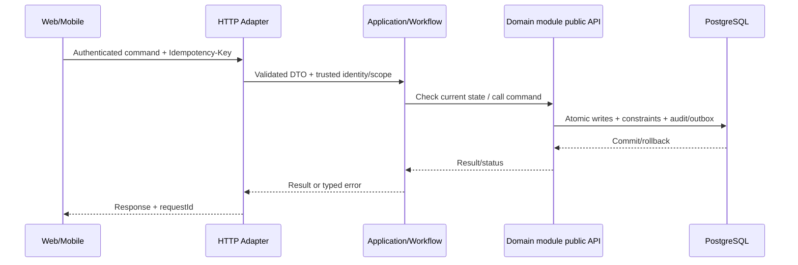

# Technical Design 005: Tạo, xác nhận, hủy và tracking vận đơn

**State:** DESIGN_PROPOSED — không mô tả API/migration đã implement.  
**Source:** `spec.md`, `docs/architecture/*`, [REPORT] Chương 3–4.

## 1. Bounded context / code location
- Primary owner: `order, workflow`.
- Backend: `apps/backend/src/main/java/com/example/elogistics/<module>/api/` và `internal/{web,application,domain,infrastructure}/`.
- Application coordination xuyên module chỉ ở `workflow`, gọi public contracts; không truy cập trực tiếp `othermodule.internal`.
- Web: `apps/web/src/features/shipment-lifecycle/` khi có màn hình liên quan. Mobile: `apps/shipper-mobile/src/features/shipment-lifecycle/` nếu shipper thao tác.

## 2. Domain model & persistence boundary
order.shipment, parcel, addresses, quote_snapshot, tracking_event, idempotency record; dependencies referenced via public IDs.

**Database rules:** owner schema; foreign/unique/check/conditional update theo `docs/architecture/data-ownership.md`; append-only cho ledger/stock movement/tracking/audit; migration mới thay vì ORM auto-DDL. Không tạo bảng cho dữ liệu chưa có use case.

## 3. Public API proposal — cần đưa vào OpenAPI sau review
POST /api/v1/shipments (DRAFT); POST /api/v1/shipments/{id}/confirm; POST /api/v1/shipments/{id}/cancel; GET /api/v1/shipments/{id}; GET /api/v1/public/tracking/{code}.

- `Authorization`: role + scope + ownership theo FR/BR; request owner ID không phải nguồn đáng tin.
- Mutation dùng `Idempotency-Key` ở điểm có tác động, `X-Request-Id` để correlate; DTO được validate, lỗi có stable `error.code`.
- Trạng thái gợi ý: `201` create, `200` query/commit, `202` deferred/unknown, `400/422` invalid input/business, `401/403/404` auth, `409` duplicate/state, `503` dependency; cụ thể hóa tại `contracts/openapi/`.
- Không trả toàn bộ persistence entity/JPA object; output use case DTO tối thiểu.

## 4. Data flow / transaction boundary

**Feature-specific atomicity:** Single local transaction across workflow→Pricing(validate), Warehouse(reserve if WMS), Finance(charge), Order(confirm+snapshot+tracking); outside integrations pre-resolved.

## 5. Events, async / retry
ShipmentConfirmed/ShipmentCancelled/ShipmentStatusChanged in source outbox; notification asynchronously.

- Với event thật: versioned envelope `eventId`, `eventType`, `version`, `aggregateId`, `occurredAt`, `correlationId`, minimal payload; outbox commit cùng source; consumer inbox idempotent.
- Retry bounded/backoff và failed job state; callback/scan được dedupe theo business scope, không tin RabbitMQ bảo đảm exactly-once.

## 6. Lỗi / bảo mật / UI state
- **Failure semantics:** Thiếu tiền, hết tồn, quote expired, outdated address, double confirm, mất kết nối sau commit, hủy sau picking → reject/pending mà không commit dang dở.
- **AuthZ:** enforce tại server theo actor và object, bao gồm read, update và async recovery.
- **UI:** loading/success/validation conflict/pending-verification/offline states (chỉ khi phù hợp); giữ input khi request lỗi; optimistic UI không thay business truth.
- **Audit & privacy:** lưu actor + target + trace + reason cho operation nhạy cảm; mask token, PII, GPS và payment key trong log.

## 7. Kiểm thử kỹ thuật (thiết kế trước khi code)
State-transition matrix, Testcontainers confirm insufficient funds/stock rollback, concurrent same shipment, replay, tenant auth, E2E with pricing and finance.

| Loại test | Bảo đảm |
| --- | --- |
| Unit `TEST-005-UNIT-*` | REQ, guard, edge state |
| Integration `TEST-005-INT-*` | Postgres transaction/constraint, owner boundary, API |
| Concurrency `TEST-005-CONC-*` | Zero duplicate effects, invariant under interleaving |
| E2E `TEST-005-E2E-*` | User journey, pending/conflict/error UX |
| Fault `TEST-005-FAULT-*` | Timeout/retry/crash + recovery states |

## 8. Interfaces & dependencies
Feature prerequisites: 001, 002, 003, 004, 006, 007. Không thêm call cycle; nếu thiếu contract, tạo/duyệt public interface trước khi implement service.

## 9. Security/performance/operability
- Đo metric theo NFR liên quan NFR-C01, NFR-C02, NFR-S01 và tên operation.
- Load benchmark không tạo số liệu giả; dùng cùng seed/fixture và môi trường được công bố.
- Test RBAC/tenant scoping và no token/log sensitive data.

## 10. Decisions to close before implementation
[BLOCKING] Chính sách fee refund khi hủy, allowed cancel state chính xác theo flow; shipment code format; các bắt buộc tối thiểu khi tạo draft.

Mọi endpoint/tên bảng/field mới trong tài liệu là **[PROPOSED]**; báo cáo không định nghĩa đầy đủ API/migration. Sau khi duyệt, khóa hợp đồng ở `contracts/openapi/` và ghi ADR khi quyết định mang tính kiến trúc.

## V3 reconciliation overlay — PROPOSED, 2026-10-26

ID/nội dung/checkbox cũ giữ nguyên lịch sử; candidate không DONE/REPORT/accepted decision. Target: [L006 order-shipment-parcel-contract](../../specs/planning/v3/L006-order-shipment-parcel-contract/spec.md); [L007 shipment-booking-sender-payments](../../specs/planning/v3/L007-shipment-booking-sender-payments/spec.md); [L009 tracking-event-core-public-lookup](../../specs/planning/v3/L009-tracking-event-core-public-lookup/spec.md); [L015 lastmile-attempt-pod](../../specs/planning/v3/L015-lastmile-attempt-pod/spec.md); [L016 returns-reverse-logistics](../../specs/planning/v3/L016-returns-reverse-logistics/spec.md). [Crosswalk](../../docs/reconciliation/v3/legacy-crosswalk.csv) SPLIT/EXTEND/PRESERVE là scope relation, không automatic equivalence.

Source thật app/backend/src/main/java/com/elogistic/backend, app/frontend/web, app/frontend/shipper-mobile; apps/com.example cũ chỉ blueprint.9 domains giữ DML ownership, không internals import. L006: BE Aggregate/state ownership, direct/WMS cancel cutoff/hold; workflow qua API; FE Trang Shipment trình bày state/errors, không UI riêng cho contract; L007: BE Workflow validate quote, finance charge, warehouse reserve nếu WMS, orders confirm cùng transaction; FE Sender/Merchant booking/cancel/payment pending/receipt/retry; L009: BE Canonical append-only events, privacy projection/rate limit; FE Public masked tracking; Sender owned/Merchant scoped timeline; L015: BE Orders attempt/POD/result, dispatch authority, finance collection cùng workflow; FE Courier scan/POD/failure/retry; Recipient đưa evidence ngoài account; L016: BE Orders return/state; dispatch reverse custody; warehouse QC khi WMS; FE Sender/Merchant yêu cầu/theo dõi; Operations tasks; Courier handover. Schema/API mới PROPOSED trước review.

[Delivery/DoR/DoD](../../docs/reconciliation/v3/delivery-plan.md). Research016 chỉ RQ/L030, không Returns. T-003-01 còn mở cho authority/address/enrollment; [first packet](../planning/v3/first-business-slice/spec.md).
