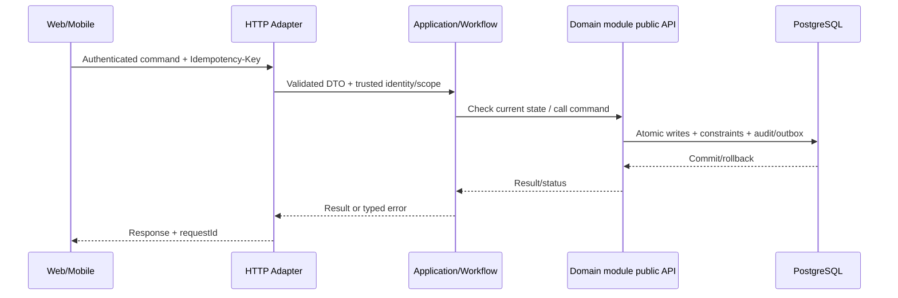

# Technical Design 008: Hub Operations, manifest, custody và assignment

**State:** DESIGN_PROPOSED — không mô tả API/migration đã implement.  
**Source:** `spec.md`, `docs/architecture/*`, [REPORT] Chương 3–4.

## 1. Bounded context / code location
- Primary owner: `dispatch`.
- Backend: `apps/backend/src/main/java/com/example/elogistics/<module>/api/` và `internal/{web,application,domain,infrastructure}/`.
- Application coordination xuyên module chỉ ở `workflow`, gọi public contracts; không truy cập trực tiếp `othermodule.internal`.
- Web: `apps/web/src/features/dispatch-hub/` khi có màn hình liên quan. Mobile: `apps/shipper-mobile/src/features/dispatch-hub/` nếu shipper thao tác.

## 2. Domain model & persistence boundary
dispatch.hub, trip, leg, manifest, manifest_item, assignment, custody_record, hub_scan, exception.

**Database rules:** owner schema; foreign/unique/check/conditional update theo `docs/architecture/data-ownership.md`; append-only cho ledger/stock movement/tracking/audit; migration mới thay vì ORM auto-DDL. Không tạo bảng cho dữ liệu chưa có use case.

## 3. Public API proposal — cần đưa vào OpenAPI sau review
POST /api/v1/trips; POST /api/v1/manifests; POST /api/v1/legs/{id}/assignments; POST /api/v1/hubs/{id}/scans; GET /api/v1/dispatch/tasks; GET /api/v1/hubs/backlog.

- `Authorization`: role + scope + ownership theo FR/BR; request owner ID không phải nguồn đáng tin.
- Mutation dùng `Idempotency-Key` ở điểm có tác động, `X-Request-Id` để correlate; DTO được validate, lỗi có stable `error.code`.
- Trạng thái gợi ý: `201` create, `200` query/commit, `202` deferred/unknown, `400/422` invalid input/business, `401/403/404` auth, `409` duplicate/state, `503` dependency; cụ thể hóa tại `contracts/openapi/`.
- Không trả toàn bộ persistence entity/JPA object; output use case DTO tối thiểu.

## 4. Data flow / transaction boundary

**Feature-specific atomicity:** Atomic deactivate old+insert active assignment protected unique partial index; scan+custody+manifest state in same transaction when business guard requires.

## 5. Events, async / retry
AssignmentChanged, ParcelHandedOver, HubBacklogDetected after commit to Notification/Projection.

- Với event thật: versioned envelope `eventId`, `eventType`, `version`, `aggregateId`, `occurredAt`, `correlationId`, minimal payload; outbox commit cùng source; consumer inbox idempotent.
- Retry bounded/backoff và failed job state; callback/scan được dedupe theo business scope, không tin RabbitMQ bảo đảm exactly-once.

## 6. Lỗi / bảo mật / UI state
- **Failure semantics:** Scan trùng, thiếu kiện, sai hub, giao nhầm, reassign đồng thời, shipper hết hiệu lực → không nhân đôi custody/assignment.
- **AuthZ:** enforce tại server theo actor và object, bao gồm read, update và async recovery.
- **UI:** loading/success/validation conflict/pending-verification/offline states (chỉ khi phù hợp); giữ input khi request lỗi; optimistic UI không thay business truth.
- **Audit & privacy:** lưu actor + target + trace + reason cho operation nhạy cảm; mask token, PII, GPS và payment key trong log.

## 7. Kiểm thử kỹ thuật (thiết kế trước khi code)
Concurrent assign, double scan, wrong hub, owner scope, late scan, active unique constraint, custody continuity E2E.

| Loại test | Bảo đảm |
| --- | --- |
| Unit `TEST-008-UNIT-*` | REQ, guard, edge state |
| Integration `TEST-008-INT-*` | Postgres transaction/constraint, owner boundary, API |
| Concurrency `TEST-008-CONC-*` | Zero duplicate effects, invariant under interleaving |
| E2E `TEST-008-E2E-*` | User journey, pending/conflict/error UX |
| Fault `TEST-008-FAULT-*` | Timeout/retry/crash + recovery states |

## 8. Interfaces & dependencies
Feature prerequisites: 001, 002, 005, 007. Không thêm call cycle; nếu thiếu contract, tạo/duyệt public interface trước khi implement service.

## 9. Security/performance/operability
- Đo metric theo NFR liên quan NFR-C01, NFR-C02, NFR-S01 và tên operation.
- Load benchmark không tạo số liệu giả; dùng cùng seed/fixture và môi trường được công bố.
- Test RBAC/tenant scoping và no token/log sensitive data.

## 10. Decisions to close before implementation
[BLOCKING] Chặng nào nhận/giao trách nhiệm, hub holding threshold, manifest lifecycle, scan format and custody handover confirmation.

Mọi endpoint/tên bảng/field mới trong tài liệu là **[PROPOSED]**; báo cáo không định nghĩa đầy đủ API/migration. Sau khi duyệt, khóa hợp đồng ở `contracts/openapi/` và ghi ADR khi quyết định mang tính kiến trúc.
