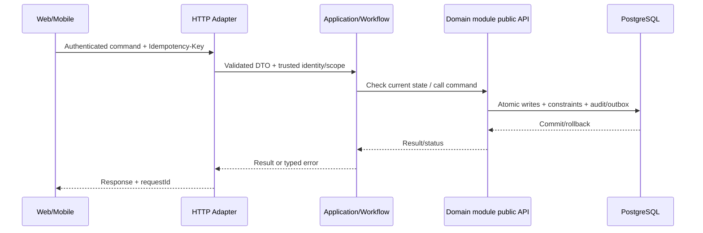

# Technical Design 010: Gợi ý tuyến, phê duyệt tuyến và GPS

**State:** DESIGN_PROPOSED — không mô tả API/migration đã implement.  
**Source:** `spec.md`, `docs/architecture/*`, [REPORT] Chương 3–4.

## 1. Bounded context / code location
- Primary owner: `routing`.
- Backend: `apps/backend/src/main/java/com/example/elogistics/<module>/api/` và `internal/{web,application,domain,infrastructure}/`.
- Application coordination xuyên module chỉ ở `workflow`, gọi public contracts; không truy cập trực tiếp `othermodule.internal`.
- Web: `apps/web/src/features/routing-location/` khi có màn hình liên quan. Mobile: `apps/shipper-mobile/src/features/routing-location/` nếu shipper thao tác.

## 2. Domain model & persistence boundary
routing.route_plan, route_stop, route_version, location_session, location_update, latest_location_projection; references to dispatch assignment.

**Database rules:** owner schema; foreign/unique/check/conditional update theo `docs/architecture/data-ownership.md`; append-only cho ledger/stock movement/tracking/audit; migration mới thay vì ORM auto-DDL. Không tạo bảng cho dữ liệu chưa có use case.

## 3. Public API proposal — cần đưa vào OpenAPI sau review
POST /api/v1/routes/proposals; POST /api/v1/routes/{id}/confirm; GET /api/v1/shipper/routes/current; POST /api/v1/location-sessions; POST /api/v1/locations/batch; GET /api/v1/dispatch/locations.

- `Authorization`: role + scope + ownership theo FR/BR; request owner ID không phải nguồn đáng tin.
- Mutation dùng `Idempotency-Key` ở điểm có tác động, `X-Request-Id` để correlate; DTO được validate, lỗi có stable `error.code`.
- Trạng thái gợi ý: `201` create, `200` query/commit, `202` deferred/unknown, `400/422` invalid input/business, `401/403/404` auth, `409` duplicate/state, `503` dependency; cụ thể hóa tại `contracts/openapi/`.
- Không trả toàn bộ persistence entity/JPA object; output use case DTO tối thiểu.

## 4. Data flow / transaction boundary

**Feature-specific atomicity:** Matrix external outside DB transaction; route confirmation checks assignment current + sets single effective version atomically; location updates independent, bounded writes.

## 5. Events, async / retry
RouteConfirmed/LocationSessionStopped; location stream realtime implementation [PROPOSED] polling vs websocket needs ADR.

- Với event thật: versioned envelope `eventId`, `eventType`, `version`, `aggregateId`, `occurredAt`, `correlationId`, minimal payload; outbox commit cùng source; consumer inbox idempotent.
- Retry bounded/backoff và failed job state; callback/scan được dedupe theo business scope, không tin RabbitMQ bảo đảm exactly-once.

## 6. Lỗi / bảo mật / UI state
- **Failure semantics:** Provider matrix lỗi, vô nghiệm, stale assignment lúc confirm, GPS timestamp sai/out-of-order, session tắt → từ chối hoặc fallback được đánh dấu.
- **AuthZ:** enforce tại server theo actor và object, bao gồm read, update và async recovery.
- **UI:** loading/success/validation conflict/pending-verification/offline states (chỉ khi phù hợp); giữ input khi request lỗi; optimistic UI không thay business truth.
- **Audit & privacy:** lưu actor + target + trace + reason cho operation nhạy cảm; mask token, PII, GPS và payment key trong log.

## 7. Kiểm thử kỹ thuật (thiết kế trước khi code)
Route constraints, stale data, parallel versions, matrix missing, p95 compute/matrix separated, <=10s 50 points, GPS <=5s server-to-UI under declared conditions.

| Loại test | Bảo đảm |
| --- | --- |
| Unit `TEST-010-UNIT-*` | REQ, guard, edge state |
| Integration `TEST-010-INT-*` | Postgres transaction/constraint, owner boundary, API |
| Concurrency `TEST-010-CONC-*` | Zero duplicate effects, invariant under interleaving |
| E2E `TEST-010-E2E-*` | User journey, pending/conflict/error UX |
| Fault `TEST-010-FAULT-*` | Timeout/retry/crash + recovery states |

## 8. Interfaces & dependencies
Feature prerequisites: 001, 002, 008. Không thêm call cycle; nếu thiếu contract, tạo/duyệt public interface trước khi implement service.

## 9. Security/performance/operability
- Đo metric theo NFR liên quan NFR-P03, NFR-P04, NFR-S05 và tên operation.
- Load benchmark không tạo số liệu giả; dùng cùng seed/fixture và môi trường được công bố.
- Test RBAC/tenant scoping và no token/log sensitive data.

## 10. Decisions to close before implementation
[BLOCKING] Map tiles/geocoding/matrix provider, coverage, license and credentials; route baseline algorithm; optimization constraints; GPS stale/accuracy thresholds and location transport.

Mọi endpoint/tên bảng/field mới trong tài liệu là **[PROPOSED]**; báo cáo không định nghĩa đầy đủ API/migration. Sau khi duyệt, khóa hợp đồng ở `contracts/openapi/` và ghi ADR khi quyết định mang tính kiến trúc.
