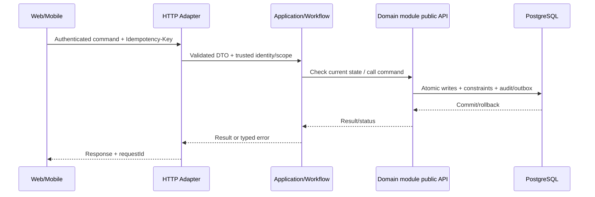

# Technical Design 014: Import Excel tạo đơn nháp có preview và báo lỗi từng dòng

**State:** DESIGN_PROPOSED — không mô tả API/migration đã implement.  
**Source:** `spec.md`, `docs/architecture/*`, [REPORT] Chương 3–4.

## 1. Bounded context / code location
- Primary owner: `order`.
- Backend: `apps/backend/src/main/java/com/example/elogistics/<module>/api/` và `internal/{web,application,domain,infrastructure}/`.
- Application coordination xuyên module chỉ ở `workflow`, gọi public contracts; không truy cập trực tiếp `othermodule.internal`.
- Web: `apps/web/src/features/bulk-shipment-import/` khi có màn hình liên quan. Mobile: `apps/shipper-mobile/src/features/bulk-shipment-import/` nếu shipper thao tác.

## 2. Domain model & persistence boundary
order.import_job, import_row_result, shipment_draft; file upload temp storage lifecycle and checksum.

**Database rules:** owner schema; foreign/unique/check/conditional update theo `docs/architecture/data-ownership.md`; append-only cho ledger/stock movement/tracking/audit; migration mới thay vì ORM auto-DDL. Không tạo bảng cho dữ liệu chưa có use case.

## 3. Public API proposal — cần đưa vào OpenAPI sau review
POST /api/v1/shipments/imports/preview; POST /api/v1/shipments/imports/{jobId}/commit; GET /api/v1/shipments/imports/{jobId}.

- `Authorization`: role + scope + ownership theo FR/BR; request owner ID không phải nguồn đáng tin.
- Mutation dùng `Idempotency-Key` ở điểm có tác động, `X-Request-Id` để correlate; DTO được validate, lỗi có stable `error.code`.
- Trạng thái gợi ý: `201` create, `200` query/commit, `202` deferred/unknown, `400/422` invalid input/business, `401/403/404` auth, `409` duplicate/state, `503` dependency; cụ thể hóa tại `contracts/openapi/`.
- Không trả toàn bộ persistence entity/JPA object; output use case DTO tối thiểu.

## 4. Data flow / transaction boundary

**Feature-specific atomicity:** Preview read-only. On commit, per-row transaction or whole-batch semantics [BLOCKING] with dedup under unique merchant reference.

## 5. Events, async / retry
ImportCompleted summary after source state durable; notifications optional.

- Với event thật: versioned envelope `eventId`, `eventType`, `version`, `aggregateId`, `occurredAt`, `correlationId`, minimal payload; outbox commit cùng source; consumer inbox idempotent.
- Retry bounded/backoff và failed job state; callback/scan được dedupe theo business scope, không tin RabbitMQ bảo đảm exactly-once.

## 6. Lỗi / bảo mật / UI state
- **Failure semantics:** Excel sai template, formula injection, duplicate merchant reference trong cùng file hoặc DB, mất mạng khi import, role bị thu hồi → không tạo ngoài quyền.
- **AuthZ:** enforce tại server theo actor và object, bao gồm read, update và async recovery.
- **UI:** loading/success/validation conflict/pending-verification/offline states (chỉ khi phù hợp); giữ input khi request lỗi; optimistic UI không thay business truth.
- **Audit & privacy:** lưu actor + target + trace + reason cho operation nhạy cảm; mask token, PII, GPS và payment key trong log.

## 7. Kiểm thử kỹ thuật (thiết kế trước khi code)
Malicious XLSX, size limits, row-level validation, request duplicate, partial failure under declared policy, tenant boundary.

| Loại test | Bảo đảm |
| --- | --- |
| Unit `TEST-014-UNIT-*` | REQ, guard, edge state |
| Integration `TEST-014-INT-*` | Postgres transaction/constraint, owner boundary, API |
| Concurrency `TEST-014-CONC-*` | Zero duplicate effects, invariant under interleaving |
| E2E `TEST-014-E2E-*` | User journey, pending/conflict/error UX |
| Fault `TEST-014-FAULT-*` | Timeout/retry/crash + recovery states |

## 8. Interfaces & dependencies
Feature prerequisites: 002, 003, 005. Không thêm call cycle; nếu thiếu contract, tạo/duyệt public interface trước khi implement service.

## 9. Security/performance/operability
- Đo metric theo NFR liên quan NFR-C02, NFR-S03, NFR-U02 và tên operation.
- Load benchmark không tạo số liệu giả; dùng cùng seed/fixture và môi trường được công bố.
- Test RBAC/tenant scoping và no token/log sensitive data.

## 10. Decisions to close before implementation
[BLOCKING] Excel template columns, max file/rows, partial success vs all-or-nothing, retry correction policy.

Mọi endpoint/tên bảng/field mới trong tài liệu là **[PROPOSED]**; báo cáo không định nghĩa đầy đủ API/migration. Sau khi duyệt, khóa hợp đồng ở `contracts/openapi/` và ghi ADR khi quyết định mang tính kiến trúc.

## V3 reconciliation overlay — PROPOSED, 2026-10-26

ID/nội dung/checkbox cũ giữ nguyên lịch sử; candidate không DONE/REPORT/accepted decision. Target: [L023 bulk-shipment-import](../../specs/planning/v3/L023-bulk-shipment-import/spec.md). [Crosswalk](../../docs/reconciliation/v3/legacy-crosswalk.csv) SPLIT/EXTEND/PRESERVE là scope relation, không automatic equivalence.

Source thật app/backend/src/main/java/com/elogistic/backend, app/frontend/web, app/frontend/shipper-mobile; apps/com.example cũ chỉ blueprint.9 domains giữ DML ownership, không internals import. L023: BE Validate file/preview, row dedup, commit draft qua canonical booking; FE Merchant upload/preview/correct/retry/status/error download. Schema/API mới PROPOSED trước review.

[Delivery/DoR/DoD](../../docs/reconciliation/v3/delivery-plan.md). Research016 chỉ RQ/L030, không Returns. T-003-01 còn mở cho authority/address/enrollment; [first packet](../planning/v3/first-business-slice/spec.md).
